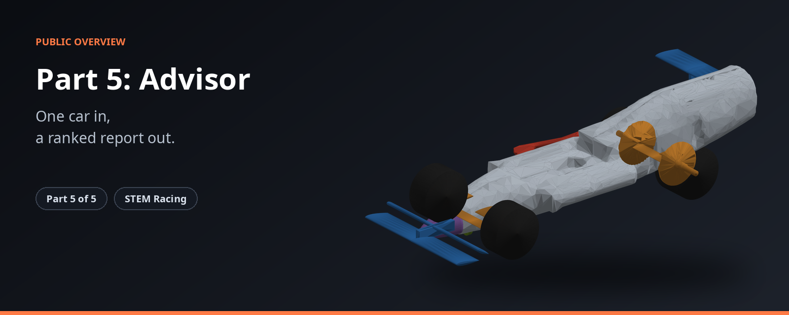
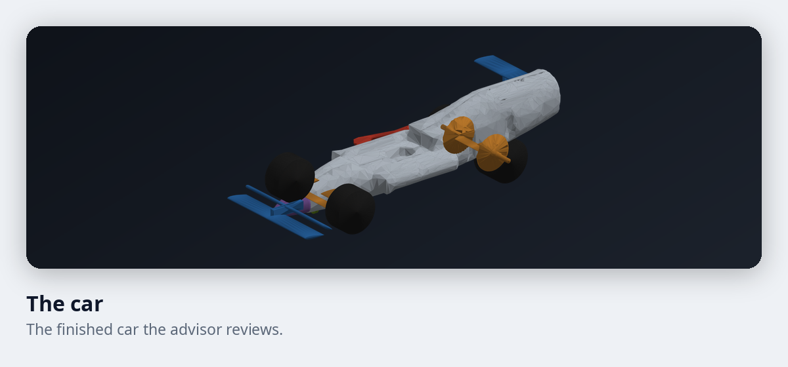
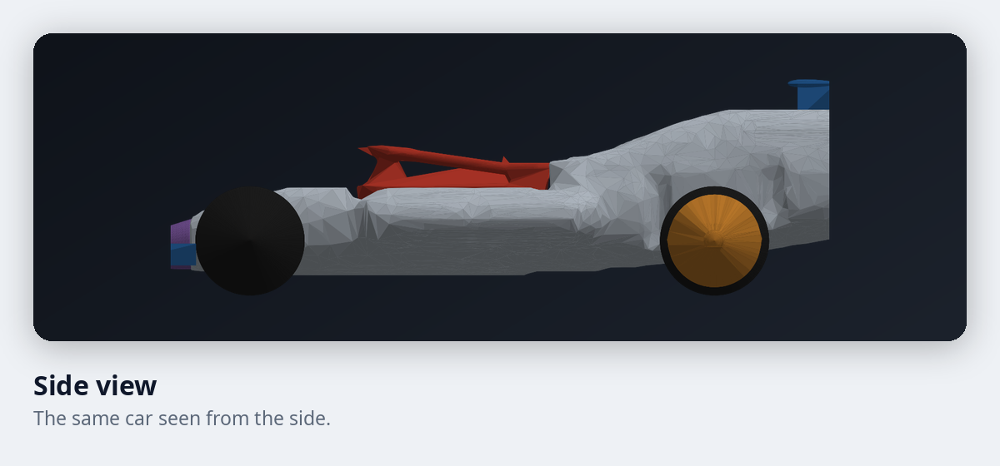

# STEM Racing, Part 5: Design advisor

**One car in, a ranked report out.**

Part 5 runs a car through everything, checks it the way a judge would, and writes up what to change.

| | |
|---|---|
| **Where it fits** | Part 5 of 5 in the STEM Racing toolkit |
| **What you get** | A ranked list of changes to try. |
| **Built for** | Student teams and their mentors |

## What it does

| Feature | What it gives you |
|---|---|
| One run, everything | Takes a car through all the parts in one go. |
| A judge's audit | Checks the finished car against the rules, with a pass or fail and the room left on each. |
| Airflow with every part | Measures the whole car, parts included, not just the body. |
| Searches for better | Tries changes to the body and the parts to look for faster versions. |
| A ranked report | Writes the recommendations in order, with the size of each gain. |

## A look at the car

<table>
<tr>
<td width="50%"></td>
<td width="50%"></td>
</tr>
</table>

These pictures are real output from the toolkit.

## How it fits

Part 5 ties the other four parts into one report. The full toolkit has five parts. See the [overview of the whole toolkit](https://github.com/Shashanksaraswat123939/stem-racing-overview).

| Part | Page |
|---|---|
| 1 | [Body](https://github.com/Shashanksaraswat123939/part1-overview) |
| 2 | [Airflow and race time](https://github.com/Shashanksaraswat123939/part2-overview) |
| 3 | [Connections](https://github.com/Shashanksaraswat123939/part3-overview) |
| 4 | [Components](https://github.com/Shashanksaraswat123939/part4-overview) |
| 5 | [Design advisor](https://github.com/Shashanksaraswat123939/part5-overview) |

## Status

| | |
|---|---|
| Project | Active |
| Source code | Private |
| This repository | Overview only, with no code |

## Credits

Made by [@Shashanksaraswat123939](https://github.com/Shashanksaraswat123939).

## Rights

This page is a public overview of a private project. It contains no source code and does not describe how the project is built.

All rights reserved. You are welcome to read this page and share the link. You may not copy, reproduce or recreate the project from this material, and you may not use it to train, prompt or instruct automated systems to produce a copy. See the [LICENSE](LICENSE) file.
